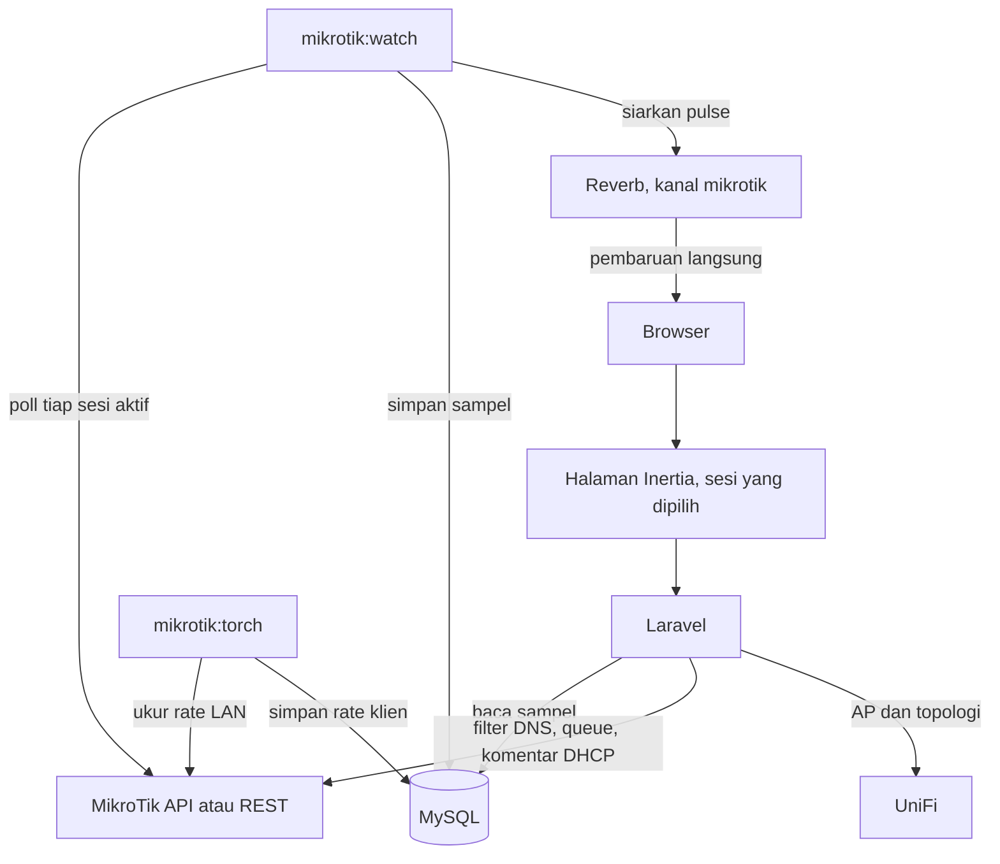
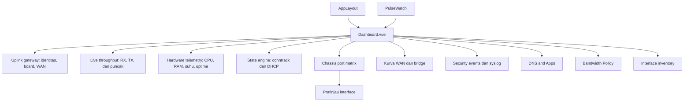
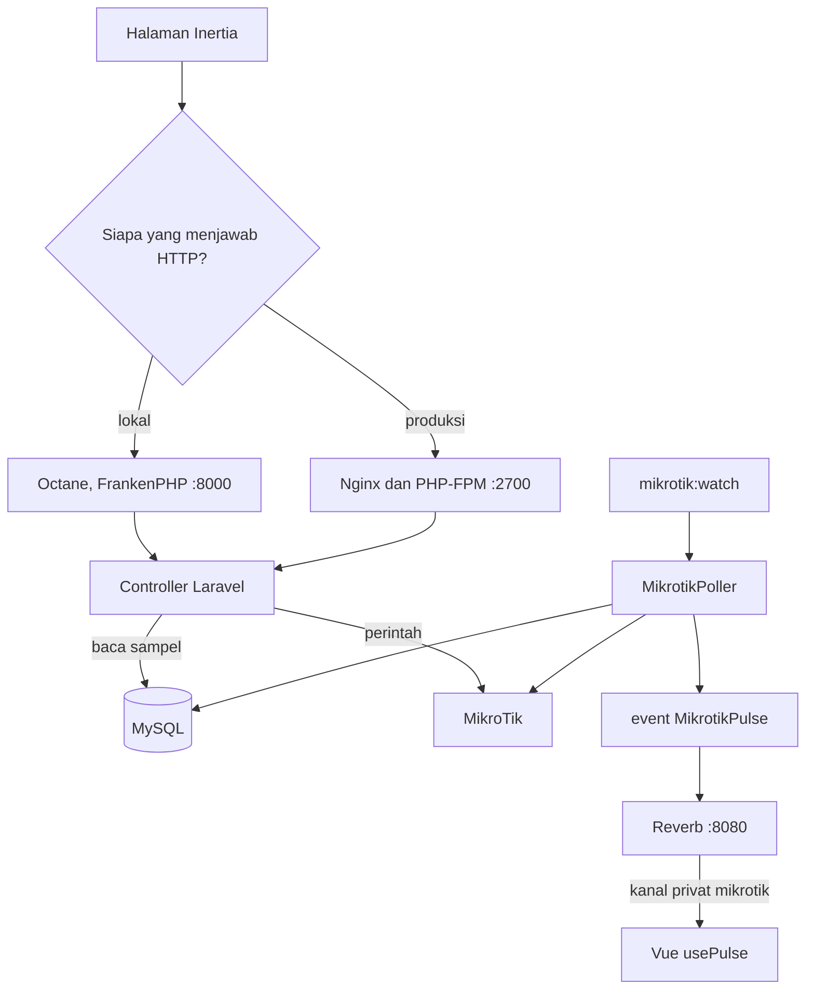
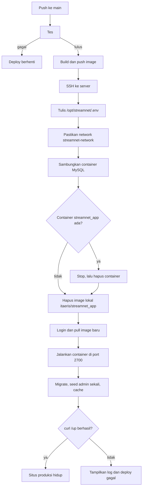

# StreamNet

Monitor gateway MikroTik. Satu proses pemantau mengambil sampel dari setiap router yang aktif, lalu dashboard menampilkan router yang sedang dipilih.

## Struktur

Browser membuka halaman Inertia untuk sesi yang dipilih. Laravel membaca sampel dari MySQL. `mikrotik:watch` menggilir setiap router aktif, menyimpan sampel, dan menyiarkan pembaruan lewat Reverb. Perintah dari halaman, seperti filter DNS dan queue, dikirim langsung ke router.



## Frontend

Halaman Vue 3 dimuat lewat Inertia dari `resources/js/app.js`. Konsol memakai `AppLayout`: sidebar, pemilih rentang waktu, dan drawer pratinjau. `usePulse` berlangganan kanal privat `mikrotik` dan event `.pulse`. `PulseWatch` di `Dashboard.vue` mendorong angka itu ke kartu tanpa memuat ulang halaman. Mode live memakai rentang 24 jam, 7 hari, atau 30 hari.

Network Overview (`Dashboard.vue`, path `/` dan `/{slug}`) tersusun seperti ini:



Kartu DNS & Apps dan Bandwidth Policy hanya ringkasan. Tautan **Buka** menuju halaman lengkapnya. Klik port di matriks atau baris inventory membuka pratinjau interface.

## Backend

Laravel menjawab halaman Inertia, login, dan perintah ke router. Controller ada di `app/Http/Controllers`. Sampel yang sudah tersimpan dibaca lewat `AnalyticsQuery`. `mikrotik:watch` memakai `MikrotikPoller` untuk mengambil data router, menulisnya ke MySQL, lalu menembakkan event `MikrotikPulse`.

**Octane** adalah server HTTP untuk mesin lokal. FrankenPHP menjalankan Laravel sebagai worker yang tetap hidup, jadi tiap permintaan tidak memuat ulang framework. `composer dev` menjalankannya di `127.0.0.1:8000` dengan `--watch`. Octane tidak memantau router dan tidak membuka websocket.

**Reverb** adalah server websocket. Event `MikrotikPulse` disiarkan ke kanal privat `mikrotik`; yang boleh berlangganan hanya user yang sudah login. Browser menerima event `.pulse` dan memperbarui angka di halaman. Di produksi, Nginx meneruskan jalur `/app` ke Reverb di `127.0.0.1:8080`. Reverb tidak menyimpan sampel dan tidak menggantikan web server.

Image produksi tidak menjalankan Octane. Container memakai Nginx dan PHP-FPM di port `2700`, plus proses terpisah untuk Reverb, `mikrotik:watch`, dan `mikrotik:torch`.



## Yang dipantau

- Ringkasan jaringan: identitas router, throughput WAN, CPU, RAM, suhu, conntrack, dan DHCP.
- Port chassis per interface, plus kurva trafik 20 menit.
- Perangkat yang terhubung lewat DHCP.
- Firewall dan temuan keamanan.
- Aliran log router.
- Beberapa sesi MikroTik sekaligus. Router lain ditambah di **Pengaturan**, bukan di `.env`.

## Menjalankan

Butuh PHP 8.3, Composer, Node.js, dan MySQL.

```bash
composer install
cp .env.example .env
php artisan key:generate
```

Isi `.env`, lalu:

```bash
php artisan migrate --force
php artisan db:seed
npm install
npm run build
composer dev
```

`composer dev` menjalankan empat proses: Octane di `127.0.0.1:8000`, Reverb, `php artisan mikrotik:watch`, dan `php artisan mikrotik:torch`. Pemantau menggilir setiap sesi yang diaktifkan setiap `MIKROTIK_POLL_SECONDS` (bawaan 5 detik).

Binary `frankenphp` diunduh ke root proyek oleh `php artisan octane:install --server=frankenphp` dan tidak ikut di-commit. FrankenPHP membawa PHP sendiri. `PHP_INI_SCAN_DIR` dikosongkan untuk proses itu (`OCTANE_PHP_INI_SCAN_DIR`) supaya tidak memuat ekstensi `.so` milik PHP sistem. Di produksi, HTTP dilayani Nginx dan PHP-FPM, bukan Octane.

Satu sampel saja:

```bash
php artisan mikrotik:watch --once
```

## Masuk

Akun operator dibuat saat seed dari:

| Variabel | Fungsi |
| --- | --- |
| `DASHBOARD_EMAIL` | Email login. Bawaan `it@aerisbeaute.com`. |
| `DASHBOARD_PASSWORD` | Password login. Kalau kosong, seeder memakai password bawaannya. |

## Sesi MikroTik

Variabel `MIKROTIK_*` hanya membuat **sesi pertama**, dan hanya kalau belum ada sesi sama sekali serta host dan password terisi.

| Variabel | Fungsi |
| --- | --- |
| `MIKROTIK_HOST` | Alamat router pertama. |
| `MIKROTIK_SCHEME` | `http` atau `https` untuk sesi REST pertama. |
| `MIKROTIK_USERNAME` | User API router. |
| `MIKROTIK_PASSWORD` | Password API router. Disimpan terenkripsi. |
| `MIKROTIK_WAN_INTERFACE` | Interface WAN. Kosongkan supaya dipilih otomatis. |
| `MIKROTIK_TIMEOUT` | Batas waktu permintaan, detik. |
| `MIKROTIK_POLL_SECONDS` | Jeda antar giliran polling. Minimum 2 detik. |
| `MIKROTIK_TORCH` | `true` supaya rate per klien diukur setelah queue (Torch di interface LAN, proses `mikrotik:torch`). |
| `MIKROTIK_TORCH_SECONDS` | Jeda antar pengukuran Torch. Bawaan 5 detik, tiap pengukuran 2 detik. |
| `MIKROTIK_LAN_INTERFACE` | Paksa interface LAN untuk Torch. Kosongkan supaya dicari dari subnet lease. |
| `MIKROTIK_CONNECTION_WARNING` | Ambang conntrack peringatan. |
| `MIKROTIK_CONNECTION_CRITICAL` | Ambang conntrack kritis. |

Daftar sesi ada di `/sesi`. Konsol sesi yang dibuka memakai slug namanya, misalnya `AERIS | FTI` menjadi `/aeris-fti` dan `/aeris-fti/bandwidth`. Pengaturan router itu ada di `/sesi/aeris-fti`. Sesi baru ditambah di `/sesi/baru`. Protokol **API** memakai port 8728 (API-SSL 8729). Itu protokol biner MikroTik, bukan HTTP. REST HTTP/HTTPS hanya dipakai kalau service `www` memang terbuka, biasanya port 80, dan alamatnya berakhiran `/rest`. Port 8728 yang tersimpan sebagai HTTP tetap dibaca sebagai API.

Password tidak dikirim balik ke halaman. Saat mengubah sesi, kosongkan password kalau tidak ingin menggantinya.

Router yang sedang dibuka dipilih dari kartu di `/sesi`, atau dari kartu **Active router** di sidebar. Pilihan itu tersimpan di sesi login. Semua halaman (ringkasan, trafik, DHCP, firewall, log) mengikuti router yang dipilih. Menghapus sesi ikut menghapus sampelnya.

Port API atau REST router harus bisa dijangkau dari mesin yang menjalankan `mikrotik:watch`. User router cukup read-only untuk `system`, `interface`, `ip/dhcp-server`, `ip/firewall`, `log`, dan `user/active`.

## UniFi

Setelah masuk, pilih sesi MikroTik di `/sesi` sebelum membuka konsol. Menu **Access Points** membaca UniFi Network Integration API (`/proxy/network/integration/v1`). API key disimpan terenkripsi di pengaturan sesi itu (`/sesi/{nama}`), jadi sesi router lain tidak memakai console yang sama. Buat API key di UniFi Network → Settings → Control Plane → Integrations.

Kalau belum dihubungkan atau console tidak bisa dijangkau, halaman Access Points menampilkan "Belum terhubung" dengan tautan ke pengaturan.

Data AP, statistik, dan klien di-cache 10 detik (`UNIFI_CACHE_SECONDS`), jadi reload Live tidak membanjiri console.

## Halaman

| Path | Vue | Isi |
| --- | --- | --- |
| `/` | `Dashboard.vue` | Network Overview: uplink, throughput, hardware, conntrack, matriks port, kurva, kejadian, dan syslog. |
| `/bandwidth` | `Bandwidth.vue` | Interface dan trafik. |
| `/dhcp` | `Dhcp.vue` | Perangkat terhubung. |
| `/dns` | `Dns.vue` | DNS dan aplikasi yang paling sering dibuka. |
| `/dns-filter` | `DnsFilter.vue` | Daftar blokir Layer 7, jadwal, dan saklar Cloudflare. |
| `/access-points` | `AccessPoints.vue` | Access point dan klien WiFi dari UniFi. |
| `/topology` | `Topology.vue` | Peta topologi. |
| `/bandwidth-policy` | `BandwidthPolicy.vue` | Queue PCQ, batas per klien, burst, dan insiden. |
| `/security` | `Security.vue` | Firewall dan temuan. |
| `/agent` | `TrafficAgent.vue` | Agen trafik, di bawah Firewall & Security. |
| `/logs` | `Logs.vue` | Aliran log. |
| `/sesi` | `Sites.vue` | Pilih dan kelola sesi router. |
| `/pengaturan` | `Settings.vue` | Akun dan pengguna. |

## Uji

```bash
composer test
```

## Deploy

Push ke `main` menjalankan `.github/workflows/deploy.yml`: tes, build image `itaeris/streamnet_app`, lalu di server container `streamnet_app` di-stop, container dan image lokalnya dihapus, image baru di-pull, lalu container jalan di port `2700` pada network `streamnet-network`. MySQL tidak dibuat ulang. `DB_HOST` di secret `BACKEND_ENV` harus nama container MySQL yang sudah ada, dan container itu harus sudah tersambung ke `streamnet-network`.



Saat container mulai, `php artisan migrate --force` hanya menambah migrasi yang belum tercatat. `AdminUserSeeder` membuat user dari `DASHBOARD_EMAIL` dan `DASHBOARD_PASSWORD` sekali. Deploy berikutnya tidak menimpa password.

Nginx di dalam container mendengarkan `2700` dan meneruskan websocket `/app` ke Reverb. Arahkan `https://stream.aeris-fti.com` ke `127.0.0.1:2700`. Di `BACKEND_ENV` produksi, set `APP_URL=https://stream.aeris-fti.com`, `REVERB_HOST=127.0.0.1`, `REVERB_PORT=8080`, `REVERB_SCHEME=http`, `VITE_REVERB_SCHEME=https`, `VITE_REVERB_PORT=443`, dan `VITE_REVERB_APP_KEY` sama dengan `REVERB_APP_KEY`. `VITE_REVERB_*` ikut ter-bake saat image di-build.
